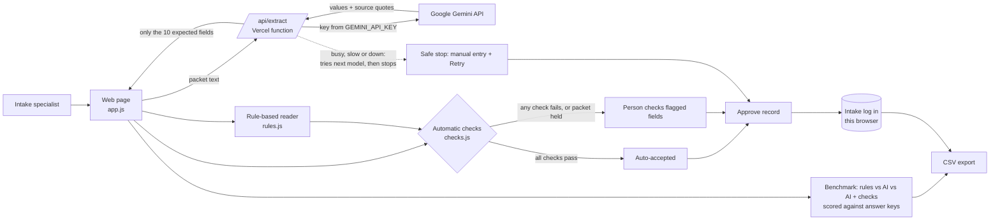

# Intake autopilot

A classroom prototype for MIS 480S Project 2. An AI reads each commercial insurance submission and fills a 10-field intake record **on its own**. Automatic checks accept the values they can confirm and send only the doubtful ones to a person (autonomy by consequence). A one-click benchmark scores three approaches on 30 labeled synthetic packets: a rule-based extractor (baseline), the AI alone, and the AI with checks.

- **User:** an intake specialist in a U.S. upper middle-market commercial insurance unit (modeled on Chubb from public sources), whose work shrinks from typing every record to checking flagged fields.
- **Live app:** https://chubb-intake-test.vercel.app
- **Repository:** https://github.com/a-ciri/chubb-intake-test (app files are in the `chubb-intake-test-bench` folder, which is Vercel's Root Directory)
- **Data:** every packet is synthetic. No real company, broker, person or policy is described. Not affiliated with or endorsed by Chubb.

## What it does

| Page | Purpose |
| --- | --- |
| Overview | How a packet is processed, and an AI connection check |
| Process a packet | Runs one packet: the AI drafts all fields with a source quote for each; the checks mark fields **Auto-accepted** or **Check** (with reasons); you approve after checking the flagged ones. Practice packets P1–P3 show the correct answers afterwards. |
| Benchmark | Runs all 30 study packets through the three approaches and scores them against hidden answer keys. Can be stopped and resumed. |
| Try your own text | Paste any text and see what the AI and checks do. Nothing is saved. |
| Data | Download the intake log and the benchmark as CSV, or delete everything |

### The automatic checks (`checks.js`)

A field is auto-accepted only if **all** of these pass. Otherwise it goes to a person, with the reasons shown:

1. **Source quote found:** the line the AI quoted is actually in the packet (catches invented values).
2. **Value in quote:** the value appears in that quote (catches values taken from the wrong place).
3. **Valid and plausible:** the value parses and falls in a sensible range.
4. **Not pending:** the quote doesn't say "TBD", "to follow", "same as expiring" and similar.
5. **Independent agreement:** the rule-based reader does not find a different value. If it finds nothing, a number is accepted only when its quote contains a single number.
6. **Packet hold:** if the packet contains instructions aimed at automated systems ("ignore previous instructions", "note for any automated system"…), every field goes to a person.

If the AI is unavailable, the system stops safely: the packet opens for manual entry and **Retry AI** is offered.

## Architecture

The function asks each model to think as little as possible (extraction needs no reasoning), tries the next available Gemini Flash model if one is busy, rate-limited, retired or slow (up to 3 models in 50 seconds), and returns token counts for cost.

## Results (benchmark run 2, November 15, 2026)

30 synthetic packets, 300 fields, gemini-3.5-flash-lite.

| Measure | Rule baseline | AI alone | AI + checks |
| --- | --- | --- | --- |
| Fields correct, of 300 | 223 (74.3%) | 300 | 300 |
| Conversational packets, of 100 fields | 23 | 100 | 100 |
| Missing values flagged, of 39 | 39 | 39 | 39 |
| Fields sent to a person | 116 | none | 34 (11.3%) |
| Auto-accepted fields that were wrong | n/a | n/a | 0 of 266 |

Run 1 gave the same AI value in all 300 fields. All 34 flagged fields were correct (false alarms), all from conversational packets. Zero errors in 300 fields still allows a true error rate of up to about 1% per field (rule of three), so the recommended release is a monitored pilot, not full autonomy. All eight live tests passed: see `TESTS.md`.

## Running the benchmark

1. Open **Benchmark** and click **Run benchmark on 30 packets**. It sends one request at a time with a short pause (Gemini free tier), so a full run took about 2 minutes on Flash-Lite (longer if a model is busy). Stay on the page.
2. If it stops (rate limit, browser closed), click **Continue**: finished packets are kept.
3. When done, click **Download benchmark CSV** and keep the file as evidence.

## Deploy (GitHub + Vercel, free tiers)

1. **Gemini key:** at [Google AI Studio](https://aistudio.google.com), **Get API key → Create API key**. No payment details. Never put the key in a file, screenshot or GitHub.
2. **GitHub:** upload the contents of this folder to a public repository.
3. **Vercel:** import the repository (framework preset **Other**, no build command). If the files sit in a subfolder, set **Root Directory** to that folder.
4. Add environment variable `GEMINI_API_KEY` (spelled exactly). Optional: `GEMINI_MODEL` to force one model. Redeploy after changing variables.
5. Open the site and use **Check AI connection** on the Overview page.

## Run locally

- With the AI: `npx vercel dev` in this folder (reads the key from a git-ignored `.env` file).
- Without the AI: `python3 -m http.server`; processing shows the safe-stop fallback.
- Unit tests: `node tests/unit.test.js` (no dependencies; Gemini is mocked).

## Files

| Path | What it is |
| --- | --- |
| `index.html`, `style.css`, `app.js` | The page, its styles and its behavior |
| `scoring.js` | Field list, value parsing (money, dates, names) and scoring |
| `rules.js` | Rule-based extractor: the no-AI baseline and an independent cross-check |
| `checks.js` | Automatic checks, packet hold and benchmark summaries |
| `api/extract.js` | Serverless function: calls Gemini, treats packet text as untrusted, returns only the expected fields, source quotes and token usage |
| `vercel.json` | Lets the function run up to 60 seconds |
| `data/packets.json` | 30 study packets (20 labeled, 10 conversational) and 3 practice packets with answers |
| `data/answer-keys.b64` | Study answer keys, base64-encoded so they are not read by accident (not security) |
| `scripts/generate_packets.py` | Regenerates packets and keys (fixed seed 480) |
| `tests/unit.test.js` | 34 automated tests |
| `TESTS.md` | The eight live tests with their results, and the D2 defect fix |

## Data dictionary

**Benchmark CSV** (one row per packet × field; 300 rows for a full run)

| Column | Meaning | Example |
| --- | --- | --- |
| `packet_id`, `style` | Study packet and its style (`labeled` or `narrative`) | `S03`, `narrative` |
| `field` | One of the 10 fields | `annual_revenue` |
| `truth` | Correct value from the answer key, or `(not in packet)` | `772300000` |
| `rules_value`, `rules_correct` | Rule-based value (or `(not found)`) and whether it was right | `(not found)`, `false` |
| `ai_value`, `ai_correct` | AI value and whether it was right | `772300000`, `true` |
| `ai_source_quote` | Text the AI says the value came from | `They closed the last fiscal year at $772.3 million…` |
| `check_result`, `check_reasons` | `auto-accepted` or `sent to person`, with the reasons | `sent to person`, `Rule check found a different value…` |
| `ai_model`, `ai_latency_s`, `tokens` | Model used, seconds the AI took, tokens used | `gemini-…-flash`, `6.2`, `1450` |

**Intake log CSV** (one row per approved study packet): packet, style, time to approve, AI status and model, AI wait time, attempts, tokens, whether the packet was held, fields auto-accepted, flagged and changed by the person, and the final 10 values with their "Not in packet" flags.

The 10 fields are named insured, broker agency, requested effective date, industry (8 categories), annual revenue, full-time employees, number of locations, total insured value, GL each-occurrence limit and claims in the past 5 years. **This field list is my assumption of a minimum intake checklist, not Chubb's actual schema.**

**Scoring:** a stated value is correct when it matches the key after normalizing (412.5M = 412,500,000; dates to YYYY-MM-DD; names ignoring case, punctuation and legal suffixes). A missing value is correct when it is marked "Not in packet". *All fields correct* counts both, over 10 fields per packet.

## Tools

- Code written with Claude (Anthropic) as an AI coding assistant, then deployed and tested by me. See the report's prompt log and AI-use disclosure.
- Google Gemini API (free tier); GitHub; Vercel (free tier); IBM Plex Sans and Source Serif 4 fonts.

## Known limits

- **Synthetic data, one author:** I wrote the packet generator and the rule-based extractor, so the rules' score on labeled packets is optimistic. Conversational packets are included partly to show where fixed rules break.
- **Plain text only:** real submissions arrive as PDFs and spreadsheets, which would need document parsing first.
- **The checks are not proof:** an AI value that is wrong but quoted correctly and unconfirmable by the rules can still be auto-accepted. The benchmark counts these as "slipped through".
- **"Final accuracy with review" assumes reviewers are always right**; that is not measured.
- **Free-tier dependence:** Gemini models and limits change; the model used is logged per packet.
- Records live in one browser's storage: export after a benchmark run.
- Answer keys sit in the public repository (encoded, not secret).
