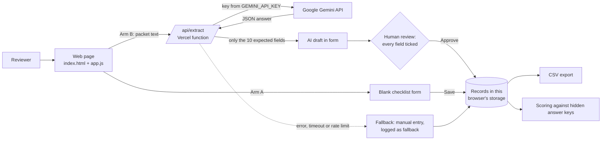

# Submission intake test bench

A classroom prototype for MIS 480S Project 2. It runs the test proposed at the end of my Project 1 brief: on the same 30 synthetic commercial Package submissions, does **AI-drafted intake with human review (Option B)** match **manual checklist intake (Option A)** on accuracy and missing-field detection, while cutting handling time?

- **User:** an intake specialist or underwriter in a U.S. upper middle-market commercial insurance unit (modeled on Chubb, from public sources), turning broker emails into a triage-ready record.
- **Live app:** _add your Vercel URL here_
- **Data:** every packet is synthetic. No real company, broker, person or policy is described. Not affiliated with or endorsed by Chubb.

## What it does

| Screen | Purpose |
| --- | --- |
| Sessions | Runs the two timed test sessions. Session 1: S01–S15 in Arm A, S16–S30 in Arm B. Session 2 swaps the arms. |
| Arm A | The packet sits beside a blank 10-field checklist; you fill every field yourself. |
| Arm B | Gemini drafts the same 10 fields. Each AI value is marked “AI draft” until you review it. **Approve stays locked until every field is reviewed.** |
| Practice | Three practice packets with answers shown after saving. P3 contains an instruction aimed at the AI (prompt-injection test). |
| Try your own text | Paste any text and see the AI draft. Nothing is saved. |
| Results | Reveals the hidden answer keys and scores both arms: field accuracy, missing-field recall, median time, and the Project 1 success criterion. |
| Data | Export records as CSV, import them on another computer, or delete them. |

If a Gemini model is busy (503), rate-limited, retired or slow, the function moves to the next available Flash model (up to 3 models within 28 seconds) and remembers the one that worked. If none answers, Arm B falls back to manual entry, offers **Retry AI draft**, and logs the record with `ai_status = fallback`. Fallback records are excluded from the Arm B score and counted separately.

## Architecture

Logged per packet: session, packet, arm, start time, duration, AI status, AI wait time, number of AI values the reviewer changed, and the 10 entered values with their “Not in packet” flags.

## Running the test

1. Do practice packets P1 and P2 in each arm until the screens feel familiar.
2. Session 1 on one day; Session 2 on a different day. Don't open `data/answer-keys.b64`.
3. After each session, go to **Data** and click **Download records CSV**. Keep the files.
4. After both sessions, go to **Results** and click **Score my records**. If the keys are revealed before both sessions are done, the page says so and records when it happened.

Entry rules (shown on the home page) are the same for both arms: enter only what the packet states; tick “Not in packet” for TBD, to follow, to be confirmed or same as expiring; revenue is the most recent fiscal year; employees are full-time only; the GL limit is each occurrence; claims are the five-year count, with 0 only when the packet says none.

## Deploy (GitHub + Vercel, free tiers)

1. **Gemini key:** at [Google AI Studio](https://aistudio.google.com), choose **Get API key → Create API key**. No payment details are needed. Never put the key in a file, a screenshot or GitHub.
2. **GitHub:** create a public repository. Click **Add file → Upload files** and drag in the *contents* of this folder (so `index.html` sits at the top level, next to the `api` and `data` folders). Commit.
3. **Vercel:** sign in with GitHub, click **Add New → Project**, and import the repository. Framework preset: **Other**. Leave the build command empty.
4. Before clicking **Deploy**, open **Environment Variables** and add `GEMINI_API_KEY` (spelled exactly) with your key. The app asks Google which models the key can use and picks the newest standard Flash model. To force one model, also add `GEMINI_MODEL` with a model ID listed in AI Studio. **Check AI connection** shows the model in use.
5. Deploy, open the URL on a laptop and a phone, and use **Check AI connection** on the home page.

Every new commit to GitHub redeploys automatically. If you add or change an environment variable after deploying, redeploy from the Vercel dashboard.

## Run locally

- With the AI: install Node.js, then run `npx vercel dev` in this folder (it reads the key from a local `.env` file that is git-ignored).
- Without the AI: `python3 -m http.server` and open `http://localhost:8000`. Arm B will show the fallback, which is useful for testing it.
- Unit tests: `node tests/unit.test.js` (no dependencies).

## Files

| Path | What it is |
| --- | --- |
| `index.html`, `style.css`, `app.js` | The page, its styles and its behavior |
| `scoring.js` | Field list, value parsing (numbers, dates, names) and scoring, shared by the page and the tests |
| `api/extract.js` | Serverless function that calls Gemini, limits input size, treats packet text as untrusted, and returns only the 10 expected fields |
| `data/packets.json` | 30 study packets (no answers) and 3 practice packets (with answers) |
| `data/answer-keys.b64` | Study answer keys, base64-encoded so they are not read by accident. This is not security: anyone can decode them. |
| `scripts/generate_packets.py` | Regenerates the packets and keys (fixed seed 480, so results are reproducible) |
| `tests/unit.test.js` | 21 automated tests for parsing, scoring and the API function (Gemini mocked) |
| `TESTS.md` | The eight test cases to run on the deployed site |

## Data dictionary: records CSV

| Column | Type | Meaning | Example |
| --- | --- | --- | --- |
| `session` | integer | Test session, 1 or 2 | `1` |
| `packet_id` | text | Study packet ID, S01–S30 | `S16` |
| `arm` | text | `A` manual checklist, `B` AI draft with review | `B` |
| `started_at` | ISO timestamp | When Start was clicked | `2026-11-11T19:02:44.120Z` |
| `duration_s` | number | Seconds from Start to Save/Approve, including AI wait and review | `104.6` |
| `ai_status` | text | `n/a` (Arm A), `ok`, or `fallback` (AI unavailable; manual entry) | `ok` |
| `ai_latency_s` | number | Seconds the AI took to return a draft (blank for Arm A) | `3.2` |
| `ai_model` | text | Gemini model that produced the draft (blank for Arm A and fallbacks) | `gemini-…-flash` |
| `fields_changed_from_ai` | integer | AI values the reviewer changed before approving (blank unless `ok`) | `1` |
| `insured_name` … `losses_5yr` | text | The 10 values entered, as typed | `412.5M` |
| `<field>_missing` | true/false | Whether “Not in packet” was ticked | `false` |

The 10 fields: named insured, broker agency, requested effective date, industry (8 categories), annual revenue, full-time employees, number of locations, total insured value, GL each-occurrence limit, claims in past 5 years. **This field list is my assumption of a minimum intake checklist, not Chubb's actual intake schema.**

Scoring: *all fields correct* = correct entries ÷ all required fields (10 per packet), where a stated value counts as correct when it matches the key and a missing value counts as correct when “Not in packet” is ticked. This combined figure splits into two measures that make up the Project 1 success criterion: *field accuracy* = stated values entered correctly ÷ stated values, and *missing-field recall* = missing values flagged “Not in packet” ÷ missing values. Numbers are compared after parsing (412.5M = 412,500,000), dates after normalizing to YYYY-MM-DD, and names ignoring case, punctuation and legal suffixes such as Inc. or LLC.

## Tools

- Code written with Claude (Anthropic) as an AI coding assistant, then reviewed, tested and deployed by me. See the report's prompt log and AI-use disclosure.
- Google Gemini API (free tier) for Arm B drafts.
- GitHub for the repository; Vercel (free tier) for hosting and the serverless function.
- Fonts: IBM Plex Sans and Source Serif 4 (Google Fonts).

## Known limits

- One reviewer (me) and 30 synthetic packets: the test shows whether the tool works under classroom conditions, not business impact at Chubb.
- The same person does every packet in both arms. Reversing the arm order between sessions offsets, but does not remove, learning effects.
- Packets are plain text; real submissions arrive as PDFs and spreadsheets, which would need document parsing.
- Records live in one browser's storage. Clearing browsing data deletes them, so export after each session.
- Answer keys are in the public repository (encoded, not secret). The test relies on the reviewer not opening them.
- Gemini's behavior and free-tier limits can change. Model names are retired often, so the app picks an available model at run time and logs the model used in every Arm B record.
